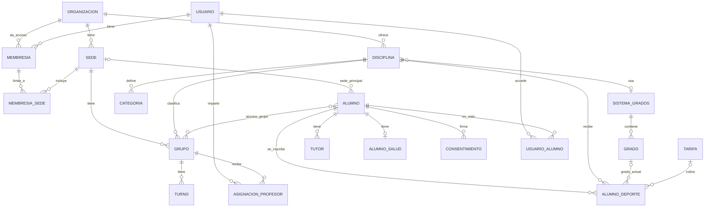

# Modelo de datos multi-escuela

Propuesta para revisión · 13/10/2026. Basada en el esquema actual (Flyway V1–V17).

## Decisiones

1. **Una base de datos compartida.** Cada tabla de negocio lleva `organizacion_id` y Hibernate 6 la
   filtra con `@TenantId` desde una superclase `EntidadOrganizacion`. Sin excepciones: también las
   tablas hijas (`turno`, `alumno_deporte`…), para que ninguna consulta dependa de un JOIN para filtrar.
2. **`usuario` es global.** Una persona puede pertenecer a varias escuelas (un profesor en dos, una
   familia con hijos en dos). Los permisos viven en `membresia`, no en el usuario.
3. **Ampliar y después contraer.** Cada cambio se hace en dos pasos: primero se añaden columnas nuevas
   y se rellenan, el código cambia a usarlas, y solo después se borran las viejas. Taemoi sigue en
   producción en cada paso.
4. **Se reutilizan tablas y filas existentes** siempre que se pueda: los 19 registros de `grado` se
   convierten en los grados de taekwondo de Taemoi y conservan sus `id`, así que los `grado_id`
   actuales siguen siendo válidos.
5. **Se mantienen los nombres actuales** (`AlumnoDeporte`, `alumno_deporte`) para reducir cambios. El
   enum `Deporte` pasa a la entidad `Disciplina`.
6. **Nada se busca por nombre.** Productos, grupos y deportes se identifican por `codigo`, `tipo` o
   clave ajena, nunca por el texto de su nombre.
7. **Los datos de salud van en una tabla aparte** (`alumno_salud`), con acceso restringido, sin caché,
   con lectura auditada y textos cifrados en reposo.
8. **La escuela activa viaja en el JWT** (claim `org`). El filtro de autenticación comprueba en cada
   petición que el usuario sigue teniendo una membresía activa en esa escuela.
9. **Durante la transición, los permisos nuevos se traducen a las autoridades actuales**
   (`ROLE_ADMIN`, `ROLE_MANAGER`, `ROLE_USER`), para no tocar de golpe los ~186 `@PreAuthorize`.
10. **Organización = empresa con cuentas propias; sede = cada escuela o local de esa empresa**
    (confirmado con el usuario, 13/10/2026). Propietario y administrador gestionan todas las
    sedes; el responsable de sede, solo las suyas. En la interfaz se usa «Sede».
11. **Administrador de plataforma** (fase 3): marca global en `usuario` (`es_admin_plataforma`), no
    una membresía. Solo él ve los errores técnicos de la API y la configuración de plataforma, de
    todas las escuelas. El propietario ve el registro de acciones de su escuela (quién cambió qué)
    pero no los errores técnicos; administrador, responsable de sede y profesor no ven ninguno.
    Confirmado con el usuario (13/10/2026).
12. **Web pública editable por escuela** (fase 4, cambio del 13/10/2026): plantilla con bloques
    editables (textos, imágenes, colores, orden), no editor libre. Horarios, tarifas, eventos,
    sedes y preinscripción se alimentan de la gestión. Escuela resuelta por dominio o subdominio.
    El primer cliente la necesita para su alta. Sustituye a la decisión anterior:
14. **Panel de gestión en tiempo real** (tras la fase 3, petición del usuario 13/10/2026): varias
    personas usan el panel a la vez y todas deben ver lo mismo. Avisos por SSE por escuela,
    filtrados por sede y permisos, que refrescan las pantallas abiertas; y bloqueo optimista
    (`@Version`) en los registros editables para que una edición simultánea dé conflicto (409) en
    lugar de sobrescribir en silencio.
13. ~~**La web pública de Taemoi (SEO, landings) no se generaliza en esta fase.** La escuela nueva
    empieza usando solo la aplicación de gestión.~~ (descartada)

## Diagrama

## Tablas nuevas

### `organizacion` (global)

| Columna | Tipo | Nota |
|---|---|---|
| `id` | BIGINT PK | Taemoi = 1 |
| `slug` | VARCHAR(60) UNIQUE | `taemoi`, `sierra-sur` |
| `nombre` | VARCHAR(150) NOT NULL | Nombre comercial |
| `nombre_legal`, `cif` | VARCHAR(200), VARCHAR(16) | Para certificados y recibos |
| `direccion`, `localidad`, `provincia`, `codigo_postal` | VARCHAR | Domicilio social |
| `email_contacto`, `telefono`, `web_url` | VARCHAR | Contacto público |
| `logo_imagen_id` | FK `imagen` | Logo en web, correos y PDF |
| `color_primario` | CHAR(7) | `#RRGGBB` |
| `email_remitente_nombre` | VARCHAR(100) | Sustituye a `app.mail.from-name` |
| `firmante_nombre`, `firmante_cargo`, `firmante_nif` | VARCHAR | Sustituyen a las constantes de `TesoreriaServiceImpl` |
| `zona_horaria` | VARCHAR(40) | `Europe/Madrid` por defecto |
| `activa`, `creada_en` | BOOLEAN, DATETIME | |

Los datos legales del firmante **no van en ninguna migración** (el repositorio no debe contener DNI):
se cargan desde el panel de administración o con SQL manual fuera del repositorio.

### `sede`

| Columna | Tipo | Nota |
|---|---|---|
| `id`, `organizacion_id` | BIGINT | |
| `nombre` | VARCHAR(100) | UNIQUE (`organizacion_id`, `nombre`) |
| `direccion`, `localidad`, `codigo_postal`, `telefono`, `email` | VARCHAR | |
| `codigo_club_federacion` | VARCHAR(40) | Nombre del club en la federación, p. ej. «TKD CASARICHE» |
| `aforo_turno` | INT NULL | Si es nulo, se usa `limite_turno` de la configuración |
| `activa` | BOOLEAN | |

### `configuracion_organizacion` y `contador`

- `configuracion_organizacion` (`organizacion_id`, `clave` VARCHAR(80), `valor` VARCHAR(255)), PK
  (`organizacion_id`, `clave`). Sustituye a `configuracion_sistema` (hoy solo `limite_turno`).
- `contador` (`organizacion_id`, `clave` VARCHAR(40), `valor` BIGINT), PK (`organizacion_id`, `clave`).
  Genera `numero_expediente` por escuela con `SELECT … FOR UPDATE`, en lugar del `MAX()+1` actual,
  que además tiene una condición de carrera.

### Permisos: `membresia`, `membresia_sede`, `usuario_alumno`, `asignacion_profesor`

| Tabla | Columnas | Nota |
|---|---|---|
| `membresia` | `id`, `usuario_id`, `organizacion_id`, `rol` ENUM(`PROPIETARIO`, `ADMINISTRADOR`, `RESPONSABLE_SEDE`, `PROFESOR`, `FAMILIA`), `cargo` VARCHAR(100), `activa` | UNIQUE (`usuario_id`, `organizacion_id`, `rol`). `cargo` = «Director técnico», «Técnico deportivo»… Sustituye a `usuario_rol` |
| `membresia_sede` | `membresia_id`, `sede_id` | Solo para `RESPONSABLE_SEDE` y `PROFESOR`. Sin filas = todas las sedes |
| `usuario_alumno` | `usuario_id`, `alumno_id`, `relacion` ENUM(`PROPIO`, `TUTOR`) | Qué fichas ve una familia. Sustituye a `usuario.alumno_id` y a la comprobación por email de `AlumnoAccessControlServiceImpl` |
| `asignacion_profesor` | `organizacion_id`, `usuario_id`, `grupo_id`, `rol` ENUM(`TITULAR`, `AYUDANTE`) | PK (`usuario_id`, `grupo_id`) |

Traducción provisional a autoridades actuales (decisión 9): `PROPIETARIO` → `ROLE_ADMIN`
(ya incluye todo lo de `ROLE_MANAGER`); `ADMINISTRADOR` → `ROLE_MANAGER`; `FAMILIA` → `ROLE_USER`. `RESPONSABLE_SEDE` y
`PROFESOR` necesitan comprobaciones nuevas por sede o grupo (fase 3).

### Catálogo: `disciplina`, `sistema_grados`, `tarifa`

| Tabla | Columnas | Nota |
|---|---|---|
| `disciplina` | `id`, `organizacion_id`, `codigo` VARCHAR(40), `nombre`, `sistema_grados_id` NULL, `permite_competicion`, `requiere_licencia`, `edad_adulto` TINYINT, `producto_licencia_id` NULL, `producto_competidor_id` NULL, `orden`, `activa` | UNIQUE (`organizacion_id`, `codigo`). `codigo` conserva los valores del enum (`TAEKWONDO`…). Sin sistema de grados = disciplina sin grados (Pilates, DPF). `edad_adulto` sustituye a los 14/15 de `FechaUtils` |
| `sistema_grados` | `id`, `organizacion_id`, `nombre`, `plantilla_origen` VARCHAR(40) | Taemoi tendrá dos: taekwondo y kickboxing |
| `tarifa` | `id`, `organizacion_id`, `disciplina_id` NULL, `codigo` VARCHAR(40), `nombre`, `importe` DECIMAL(8,2), `importe_adulto` NULL, `importe_menor` NULL, `activa` | UNIQUE (`organizacion_id`, `codigo`). Sustituye a `TipoTarifa` + `TarifaConfig`. Los importes adulto/menor cubren `PADRES_HIJOS` |

### Personas: `tutor`, `alumno_salud`, `consentimiento`

| Tabla | Columnas | Nota |
|---|---|---|
| `tutor` | `id`, `organizacion_id`, `alumno_id`, `nombre`, `apellidos`, `nif`, `parentesco` ENUM(`PADRE`, `MADRE`, `TUTOR_LEGAL`, `OTRO`), `telefono`, `email`, `responsable_legal` BOOLEAN, `orden` | Sustituye a `responsable_legal_nombre`/`_nif` de `alumno` |
| `alumno_salud` | `alumno_id` PK, `organizacion_id`, `lesion_enfermedad` BOOLEAN NULL, `descripcion` TEXT, `impide_actividad` BOOLEAN NULL, `impide_detalle` TEXT, `alergias` TEXT, `origen` ENUM(`FICHA_PAPEL`, `PREINSCRIPCION`, `APP`), `actualizado_en` | Textos cifrados (AES-GCM, clave por variable de entorno). Solo lo leen propietario, administración y profesores del alumno |
| `consentimiento` | `id`, `organizacion_id`, `alumno_id`, `tipo` ENUM(`NORMAS`, `PRIMEROS_AUXILIOS`, `USO_IMAGEN`, `COMPROMISO_PAGO`, `PROTECCION_DATOS`), `otorgado`, `fecha` DATE, `fecha_aproximada` BOOLEAN, `firmante_nombre`, `firmante_relacion` ENUM(`PROPIO`, `TUTOR`), `origen`, `documento_id` NULL, `preinscripcion_id` NULL | La ficha escaneada se enlaza como documento. `alumno.autorizacion_web` se mantiene y se sincroniza con el último `USO_IMAGEN` |

## Cambios en tablas existentes

| Tabla | Cambios |
|---|---|
| `alumno` | + `organizacion_id`, `sede_principal_id` NULL, `genero` ENUM(`FEMENINO`, `MASCULINO`) NULL, `localidad`, `codigo_postal`. `telefono`/`telefono2`: INT → VARCHAR(20) y `telefono` pasa a NULL (hay fichas sin teléfono; se valida en el alta). UNIQUE `numero_expediente` → UNIQUE (`organizacion_id`, `numero_expediente`). Nuevo UNIQUE (`organizacion_id`, `nif`). Contracción: se borran las columnas heredadas (`deporte`, `grado_id`, `fecha_grado`, `apto_para_examen`, tarifa, competición y licencia) y `responsable_legal_*` |
| `alumno_deporte` | + `organizacion_id`. `deporte` → `disciplina_id` (UNIQUE (`alumno_id`, `disciplina_id`)). `tipo_tarifa` → `tarifa_id`; `cuantia_tarifa` se queda como precio particular. `grado_id` apunta al grado del sistema de su disciplina |
| `grado` | Se reutiliza. + `organizacion_id`, `sistema_grados_id`, `codigo` (= antiguo `tipo_grado`), `nombre`, `orden`, `color_1`, `color_2`, `aplica_a` ENUM(`TODOS`, `MENORES`, `ADULTOS`), `equivalente_adulto_id` NULL, `requiere_examen`, `meses_minimos_menor`, `meses_minimos_adulto`, `bloque_temario`, `producto_examen_id` NULL, `producto_recompensa_id` NULL. UNIQUE (`sistema_grados_id`, `codigo`). Contracción: se borra `tipo_grado` |
| `categoria` | + `organizacion_id`, `disciplina_id`, `edad_min`, `edad_max`, `peso_min`, `peso_max`, `orden`. Contracción: se borra `tipo_categoria` |
| `producto` | + `organizacion_id`, `codigo` NULL, `tipo` ENUM(`MENSUALIDAD`, `RESERVA_PLAZA`, `LICENCIA`, `COMPETIDOR`, `EXAMEN`, `RECOMPENSA`, `OTRO`), `disciplina_id` NULL. UNIQUE (`organizacion_id`, `codigo`). La lógica busca por `tipo` + `disciplina`, no por `concepto` |
| `grupo` | + `organizacion_id`, `sede_id` NOT NULL. `deporte` → `disciplina_id`. `tipo` con valores cerrados (`INFANTIL`, `JOVEN`, `ADULTO`, `COMPETICION`, `OTRO`). UNIQUE (`sede_id`, `nombre`) |
| `turno` | + `organizacion_id`. Se elimina `Turno.getTipoTurno()`: el tipo sale del grupo |
| `convocatoria` | + `organizacion_id`. `deporte` → `disciplina_id` |
| `alumno_convocatoria` | + `organizacion_id`. `grado_actual`/`grado_siguiente` (texto) → `grado_actual_id`/`grado_siguiente_id` |
| `plantilla_preinscripcion` | + `organizacion_id`. `deporte` → `disciplina_id`. UNIQUE (`organizacion_id`, `disciplina_id`, `version`) |
| `preinscripcion` | + `organizacion_id`. `deporte` → `disciplina_id`. La columna generada `clave_preinscripcion_activa` incluye `organizacion_id` |
| `usuario` | Global. Contracción: se borran `usuario_rol` y `usuario.alumno_id` cuando `membresia` y `usuario_alumno` estén en uso |
| `producto_alumno`, `documento`, `evento`, `imagen`, `alumno_reto_diario_log`, `registro_pendiente` | Solo + `organizacion_id` |
| `auditoria_evento` | + `organizacion_id` NULL (los inicios de sesión fallidos no tienen escuela) |

Las tablas de unión (`alumno_grupo`, `alumno_turno`, `preinscripcion_turno`) no llevan
`organizacion_id`: el servicio comprueba que ambos extremos son de la misma escuela y un test lo cubre.

## Qué sustituye a cada pieza de código

| Hoy | Pasa a |
|---|---|
| enum `Deporte` y 4 columnas MySQL `ENUM` | `disciplina` |
| enum `TipoGrado`, `TipoGrado.siguiente()` | `grado` (`orden`, `aplica_a`, `equivalente_adulto_id`) |
| `GradeProgressionConfig` | `grado.orden` + `aplica_a` + `equivalente_adulto_id` |
| `ExamEligibilityConfig` | `grado.meses_minimos_menor` / `meses_minimos_adulto` |
| `ExamMaterialBlockConfig` | `grado.bloque_temario` |
| `FechaUtils` (14/15 años), `DeporteEdadUtils` | `disciplina.edad_adulto` |
| `TipoTarifa`, `TarifaConfig`, `tarifa.constants.ts` | `tarifa` |
| `TipoCategoria`, `categoria-por-edad.ts` | `categoria` |
| Productos por nombre (`"MENSUALIDAD"`, `"LICENCIA FEDERATIVA …"`, `TipoGrado.fromProductoExamen`) | `producto.tipo`/`codigo`, `disciplina.producto_*_id`, `grado.producto_*_id` |
| Deporte deducido del nombre del grupo (`GrupoServiceImpl`, `NombresGrupo`, `AlumnoRepository:255`) | `grupo.disciplina_id` |
| `Roles` + `usuario_rol` | `membresia` (+ `membresia_sede`) |
| Propiedad por email (`AlumnoAccessControlServiceImpl:47`) | `usuario_alumno` |
| `ConfiguracionSistema` | `configuracion_organizacion` |
| Marca fija (`PDFServiceImpl`, `TesoreriaServiceImpl`, plantillas de correo, `app.mail.from-name`) | columnas de `organizacion` |
| Semillas de `InicializadorDatos` (grupos, turnos, productos, categorías) | Plantilla de organización que se aplica al crear una escuela; sin semillas automáticas |
| `Documentos_Alumnos_Moiskimdo/<expediente>_…` | `org-<id>/alumnos/<alumno_id>/…`, solo ruta relativa; la URL se calcula al servir |
| `Materiales_Examen/<deporte>/<bloque>` | `org-<id>/materiales/<codigo_disciplina>/<bloque>` |
| Cachés Caffeine sin escuela | Clave con prefijo `organizacion_id` |
| Tareas `@Scheduled` globales | Un recorrido por escuela, fijando la escuela activa en cada iteración |
| UPDATE nativo de `AlumnoController.java:1968-1984` | Se elimina (migración puntual ya hecha) |

## Migración de Taemoi (Flyway V18+)

| Migración | Contenido | Fase |
|---|---|---|
| V18 | `organizacion` (Taemoi = 1, solo nombre y slug), `configuracion_organizacion` desde `configuracion_sistema`, `contador` desde `MAX(numero_expediente)` | 1 |
| V19 | `organizacion_id` en todas las tablas de negocio: añadir NULL, rellenar con 1, pasar a NOT NULL, FK e índice. Únicos compuestos | 1 |
| V20 | `membresia` desde `usuario_rol` (adelantada a la fase 1: sin ella, `ROLE_ADMIN` seguiría siendo global entre escuelas) | 1 |
| V21 | Índices por `ruta` en `imagen` y `documento` (archivos por escuela) | 1 |
| V22 | Borrado de las 14 columnas monodeporte de `alumno` (producción: ningún alumno sin `alumno_deporte`) | 2 |
| V23 | `disciplina` (4 filas desde el enum), `sistema_grados` (taekwondo y kickboxing), columnas nuevas de `grado`: las 19 filas pasan al sistema de taekwondo; se copian para kickboxing (con «Marrón» en lugar de «Rojo», como hace hoy `GradoUtils`) y se reasignan los `grado_id` de las inscripciones de kickboxing. Columnas `disciplina_id` junto a las de `deporte`, rellenadas por `codigo` | 2 |
| V24 | `tarifa` desde `TarifaConfig`; `producto.tipo`/`codigo` desde los conceptos conocidos; `alumno_deporte.tarifa_id` | 2 |
| V25 | `tutor` desde `responsable_legal_*`; `alumno_salud` y `consentimiento` vacías; `genero`, `localidad`, `codigo_postal`; teléfonos a VARCHAR | 2 |
| V27 | `sede` (sede principal de Taemoi); `grupo.sede_id` y `alumno.sede_principal_id`; `usuario_alumno` desde `usuario.alumno_id` y las coincidencias de email actuales | 3 |
| V26 | Contracción del catálogo: borrar columnas `deporte`, `tipo_grado`, `tipo_categoria`, `tipo_tarifa` y `responsable_legal_*` | 2 |
| V28+ | Contracción de permisos: borrar `usuario_rol` y `usuario.alumno_id` | 3 |

Los valores de progresión, meses mínimos y edades se copian a mano desde las clases de configuración
a V20, y los tests de caracterización de la fase 0 comprueban que el resultado es idéntico.

## Importación de «Taekwondo Sierra Sur»

1. Crear la organización, sus sedes (Casariche y las demás, con `codigo_club_federacion`) y la
   disciplina de taekwondo copiando el sistema de grados de Taemoi.
2. Profesores: un `usuario` por persona, `membresia` con rol `PROFESOR` y `cargo` según la ficha
   («Director técnico», «Técnico deportivo»), y `asignacion_profesor` a sus grupos.
3. CSV de las fichas (`plantilla-alumnos.csv`):

| Columna del CSV | Destino |
|---|---|
| `nombre`, `apellidos`, `fecha_nacimiento`, `dni`, `telefono_1`, `telefono_2` | `alumno` (`dni` → `nif`) |
| `domicilio`, `ciudad`, `codigo_postal` | `alumno.direccion`, `localidad`, `codigo_postal` |
| `anio_entrada` | `alumno.fecha_alta_inicial` = 1 de enero de ese año |
| `tutor_1_*`, `tutor_2_*` | `tutor` |
| `salud_*`, `alergias` | `alumno_salud` (`origen` = `FICHA_PAPEL`) |
| `firma`, `anio_ficha` | 4 filas de `consentimiento` (normas, primeros auxilios, uso de imagen, compromiso de pago), `fecha` = 1 de enero de `anio_ficha`, `fecha_aproximada` = true |
| `archivo_origen` | `documento` con la ficha escaneada, enlazado a los consentimientos |
| `numero_manuscrito` | `alumno.observaciones` hasta saber qué es |
| `escuela` | Validación: debe coincidir con la organización |

4. Si el portal de la federación permite exportar, ese fichero aporta `genero`, `email`, número de
   licencia y grado. Se cruza por DNI y, si falta, por nombre + apellidos + fecha de nacimiento. Los
   conflictos van a un informe; no se sobrescribe nada automáticamente.
5. Sin sede, grupo, cinturón ni tarifa en la ficha: el cliente los aporta aparte o se completan a
   mano tras la importación.

## Resultado de la fase 0

Valores exactos en `valores-actuales.md`; tests en `src-api/src/test/.../caracterizacion/`.

- **Progresión:** taekwondo menores pasa por intermedios y PUM; taekwondo adultos y kickboxing
  (todas las edades) saltan los intermedios. `aplica_a` lo cubre; PUM 3 no convierte a DAN hoy.
- **Edad adulta:** 14 (TKD) y 15 (KB) por año natural; `< 13` en exámenes usa edad cumplida. Son
  dos criterios distintos: se unifican en `disciplina.edad_adulto` y se documenta el cambio.
- **Tarifas:** `PADRES_HIJOS` = importe por rol (28/26) y `HERMANOS` = 26 fijo. Caben en `tarifa`.
- **Columnas heredadas de `alumno`:** se siguen leyendo como respaldo. Producción confirmada
  (13/10/2026): ningún alumno sin `alumno_deporte`. Antes de V25 hay que quitar esos respaldos y
  hacer que todo alta cree siempre su `alumno_deporte`. En la misma limpieza se borran
  `MigracionController`, `MigracionMultiDeporteService` y `AlumnoServiceImpl.crearAlumno(Alumno)`
  (anterior a multideporte; guarda el `Usuario` recibido en la petición).
- **Roles:** `ROLE_ADMIN` ya es superconjunto de `ROLE_MANAGER`; basta `PROPIETARIO` → `ROLE_ADMIN`.
- **Categorías:** solo para competidores de taekwondo, por edad. Van a esa disciplina.
- **DNI repetidos** (producción, 13/10/2026): 40 DNI compartidos por 81 alumnos, todos personas
  distintas (0 altas duplicadas), 33 grupos con menores. Son DNI familiares. `alumno.nif` pasa a
  ser solo el DNI propio; el del tutor va a `tutor`. Fase 2: informe de DNI compartidos con
  propuesta por grupo y revisión humana. UNIQUE (`organizacion_id`, `nif`) solo después.
- **Error encontrado:** `TipoGrado.fromProductoExamen` asigna el grado equivocado en exámenes
  intermedios. Se corrige aparte, en `develop`.

## Fuera de alcance

Normalizar `turno.dia_semana` y las horas, pasar los `Double` monetarios existentes a DECIMAL,
renombrar `AlumnoDeporte`, SMTP propio por escuela y la web pública por escuela.
